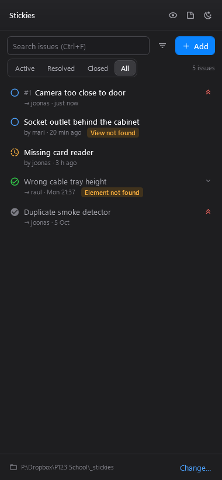
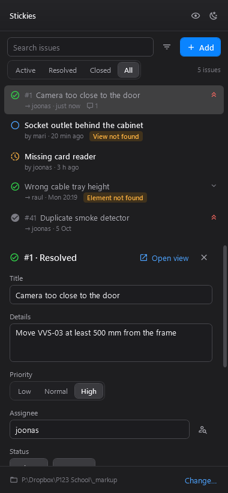
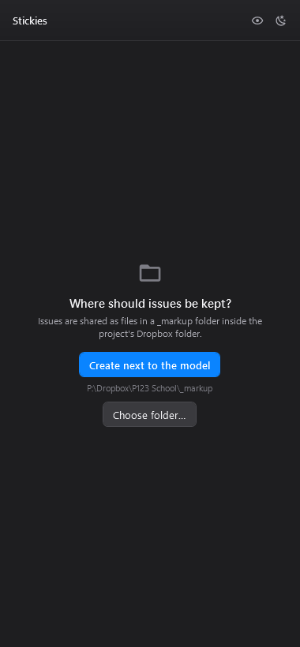
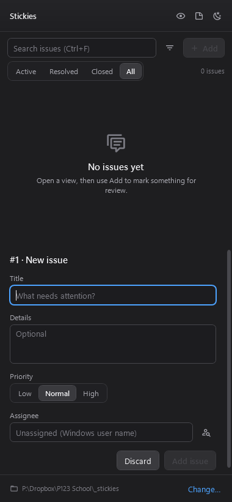
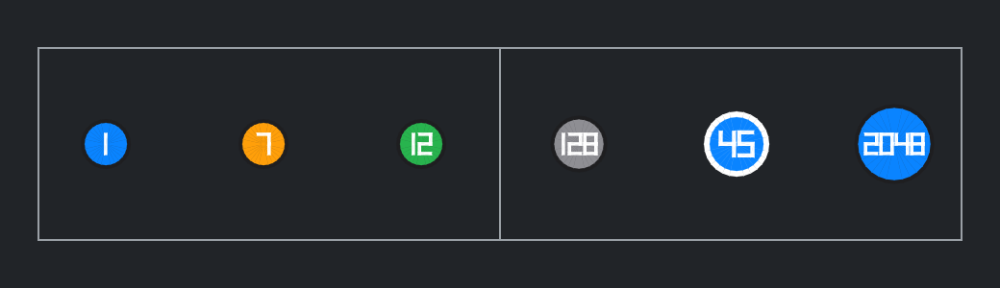
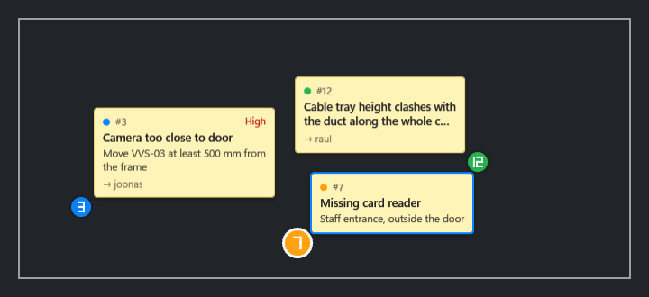
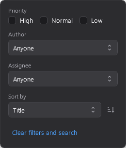
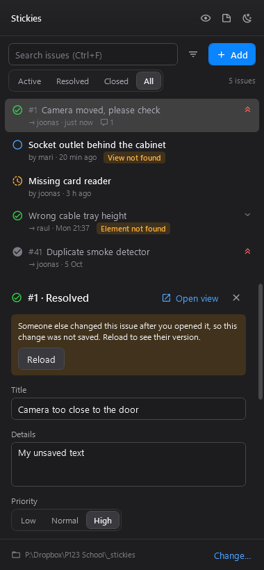
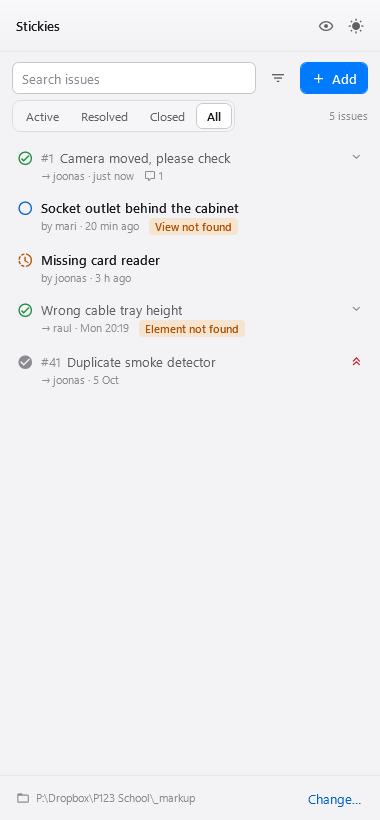

<h1>
  <picture>
    <source media="(prefers-color-scheme: dark)" srcset="docs/images/icon-dark.png">
    
  </picture>
  Stickies
</h1>

Sticky notes for drawing review in Revit.

Put a numbered note on any plan, section, elevation or 3D view: *"Camera too close to the door"*,
*"Missing card reader"*. Everyone working on the project sees it in their own Revit, can comment on it and mark it
done. No sign-in and no server: the notes are small files in the project's Dropbox folder.

The notes are drawn on top of the view and never become part of the model. They don't print, don't export, and can
never end up on a client drawing.

<p>
  
  &nbsp;
  
</p>

## Install

Stickies works with **Revit 2024** and **Revit 2026** on Windows.

1. Build `Stickies.dll` for your Revit version (see *For developers* below). A ready-made download will follow.
2. Copy `Deploy/Stickies2024.addin` (or `Stickies2026.addin`) to
   `%AppData%\Autodesk\Revit\Addins\2024\` (or `...\2026\`).
3. Open the `.addin` file in Notepad and change the `<Assembly>` line to where you put `Stickies.dll`.
4. Start Revit. Stickies is on the **RK Tools** tab.

## Getting started

Click **Stickies** on the ribbon to open the Stickies pane. You can dock it anywhere, like any other Revit panel.

The first time you open a project, Stickies asks where to keep its notes. Pick **Create next to the model** and a
`_markup` folder is made next to the model file. For a workshared model, that's next to the central file. Everyone
who opens the model from the same Dropbox folder then shares the same notes. If the model isn't in a folder (for
example a cloud model), choose the project's shared folder yourself. Stickies remembers it.



## Adding a note

1. Open the view where you see the problem.
2. Click **Add** in the pane.
3. Click the spot in the view, or select the element first if the note is about one element.
4. Give it a title, and if you like some details, a priority and who should look at it. Then click **Add issue**.

Stickies remembers the view as you saw it: its zoom, and for 3D views the section box and camera angle. Anyone who
**double-clicks** the note later gets exactly that view back.



## Working through notes

- **Click** a note to read it, edit it or add a comment.
- **Double-click** a note (or press Enter) to jump to its view.
- Move it along with **Start**, **Resolve** and **Reopen**. Whoever created a note **closes** it once they've checked
  the fix.
- A note shows *View not found* or *Element not found* when its view or element has been deleted from the model.

## Markers on views

Each note appears in the view as a numbered marker, in the colour of its status: blue for open, orange for in
progress, green for resolved, grey for closed. The note you have open gets a white ring. **Click** a marker to open
its note in the Stickies panel (the panel opens if it was closed); **double-click** it to jump to the view exactly as
it was when the note was made.

Markers show in the view where the note was made. Notes made in a 3D view also show in any other view that shows
their spot. Use the **eye** button
on the ribbon or in the pane to hide or show them.



### Notes as cards

Turn on **Cards** (the note button at the top of the pane) to also see each note as a sticky-note card next to its
marker, with its title, the start of its details and who it is assigned to. Cards show only in the view the note was
made in, and only while markers are on. Click a card to open its note, double-click it to jump to its view. Like the markers, cards are never printed or
exported.



## Finding notes

Search by any word in a note, its comments, the view name or a person. Switch between **Active**, **Resolved**,
**Closed** and **All**. The filter button narrows the list by priority, author or assignee, and sorts it. The
markers in your views follow the same filter.



Your filters, sort order and marker setting are yours: they're saved on your own computer, separately for each
project, and never shared.

## When two people edit the same note

Notes update live: when a colleague adds or changes one, it appears as soon as Dropbox has synced it. If you're editing a note that
someone else just changed, Stickies won't overwrite their change. It tells you, and **Reload** shows their version.



## Light or dark

Switch between dark and light with the button in the top corner of the pane. The ribbon icon follows Revit's own
theme.



## Where the notes are kept

```
P123 School/            the project's Dropbox folder, next to the model
  P123_EN.rvt
  _markup/
    project.json        which model these notes belong to
    active/             one small file per note
    archive/            older closed notes
```

Each note is a plain JSON file, so the folder can be backed up, synced or read by other tools.

## Status

Stickies is in early development. Planned next:
- Closed notes are tidied into monthly archive files automatically.
- Dropbox "conflicted copy" files are reported.
- Keyboard shortcuts.
- An installer.

---

### For developers

```
dotnet build Stickies.sln -c Release
dotnet test Tests/Stickies.Core.Tests -c Release
```

- `Stickies` is the add-in. It builds `Stickies.dll` for Revit 2024 (`net48`) and Revit 2026 (`net8.0-windows`) as one
  merged DLL each. Local builds go to `%UserProfile%\Desktop\DevDlls\Stickies\`. Set `StickiesUseDefaultOutput=true`
  to use `bin\` instead.
- `Stickies.Core` holds the data format and rules, with no Revit dependency. It is unit tested.
- `Tests/UiHarness` runs the real pane outside Revit and writes screenshots to `Tests/UiHarness/out/`.
- Hot reload (ricaun AppLoader) works for everything except `Stickies/Shell/PaneShell.cs`, which needs a Revit
  restart.
